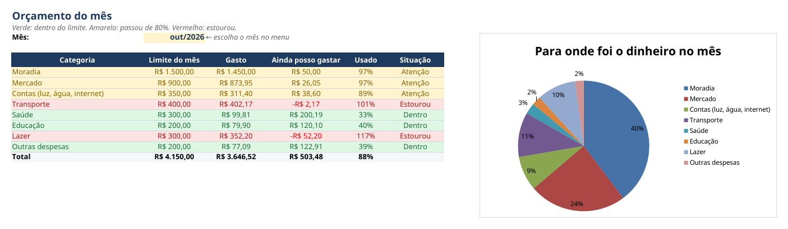
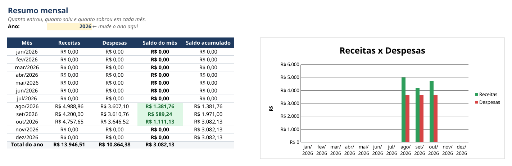
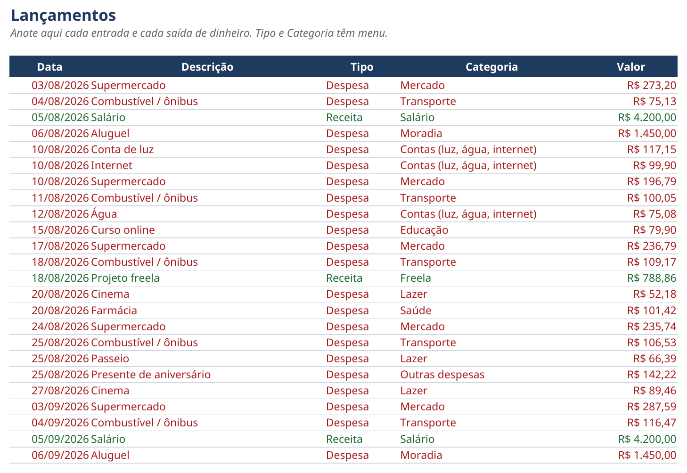

# Planilha Financeira Pessoal

Um programa em Python que **gera uma planilha Excel para controlar o seu dinheiro**: você anota receitas e despesas, e a planilha mostra sozinha o saldo de cada mês, quanto já gastou em cada categoria e um **alerta verde, amarelo ou vermelho** quando o orçamento está perto de estourar.



## O que a planilha tem

| Aba | Para que serve |
|---|---|
| **Como usar** | Instruções rápidas, para não precisar abrir este guia |
| **Lançamentos** | Onde você anota cada entrada e saída. Tipo e Categoria têm **menu de escolha**, e a planilha recusa valor ou data inválidos |
| **Orçamento** | Escolha o mês e veja o limite de cada categoria, quanto já gastou, quanto ainda pode gastar e a situação: **verde** (dentro), **amarelo** (passou de 80%) ou **vermelho** (estourou). Tem gráfico de pizza de para onde foi o dinheiro |
| **Resumo mensal** | Receitas, despesas, saldo do mês e saldo acumulado, de janeiro a dezembro, com gráfico de barras |
| **Categorias** | A lista de categorias que alimenta os menus. Dá para mudar à vontade |





## Depois de gerada, funciona sem Python

Todas as contas são **fórmulas do Excel**. O Python só monta a planilha uma vez; depois é só abrir no Excel, no LibreOffice ou no Google Planilhas e usar.

E o programa **nunca apaga os seus lançamentos**: se a planilha já existe, ele não mexe nela. Para gerar outra por cima, é preciso pedir de propósito (`--substituir`).

## Como rodar

É preciso ter o [Python](https://www.python.org/downloads/) 3.10 ou mais novo (no Windows, marque "Add python.exe to PATH" na instalação). Depois, **dois cliques** no atalho do seu sistema:

| Sistema | Atalho |
|---|---|
| Windows | `rodar_planilha.bat` |
| Mac | `rodar_planilha.command` |
| Linux | `rodar_planilha.sh` |

Na primeira vez ele prepara tudo e gera a planilha com **três meses de exemplo** (uma pessoa fictícia). Nas próximas, só abre a planilha.

Para quem prefere o terminal:

```bash
python3 -m venv .venv
source .venv/bin/activate              # no Windows: .venv\Scripts\activate
pip install -r requirements.txt
python gerar_planilha.py               # com lançamentos de exemplo
python gerar_planilha.py --em-branco   # vazia, pronta para usar
```

## Para aprender

O código está **todo comentado em português**, e o [GUIA.md](GUIA.md) explica passo a passo como cada parte foi feita: a aba de lançamentos, os menus, as fórmulas, as cores e os gráficos. A ideia é que você consiga mudar a planilha sozinho depois, por exemplo trocar as categorias, os limites ou as cores.

## Estrutura

```
planilha-financeira/
├── gerar_planilha.py   o programa que monta a planilha (comentado)
├── GUIA.md             passo a passo para entender e mudar o código
├── rodar_planilha.*    atalhos de dois cliques (Windows, Mac, Linux)
└── requirements.txt    biblioteca necessária (openpyxl)
```

## Sobre

Projeto de portfólio de **Gilmar Alberto de Abreu Pinto**, analista de sistemas em Curitiba, que também ensina programação no canal [CycleClass](https://youtube.com/@cycleclass26). Os lançamentos de exemplo são fictícios. Desenvolvido com apoio de IA (Claude).

**Quer uma planilha assim, do seu jeito, ou aprender a fazer a sua?** Me contrate pela plataforma que você já usa:

- [99Freelas](https://www.99freelas.com.br/user/GilmarAlberto)
- [Workana](https://www.workana.com/freelancer/1ccbe3135f7ebb6a82b57c41ea77d535)
